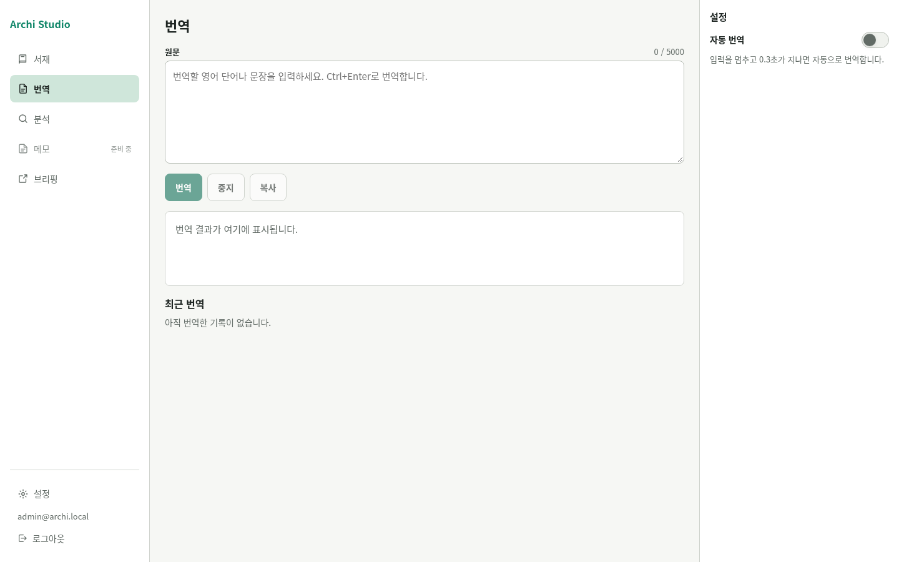

# Archi Studio

번역, 논문 분석, 서재, 메모, 브리핑을 하나의 앱으로 묶은 연구용 웹앱입니다. Zotero 서재의 논문을 중심으로 원문, 메모, 번역 이력, 분석 결과를 연결합니다.



<sub>로컬에서 띄운 빈 계정의 번역 화면입니다.</sub>

## 주요 기능

| 기능 | 하는 일 |
| --- | --- |
| 서재 | Zotero 논문 동기화, 검색, 컬렉션 탐색 |
| 번역 | 영어를 한국어로 스트리밍 번역하고 이력 저장 |
| 분석 | 초록으로 연구 문제·방법·결론 요약, 인용·저널 정보 표시 |
| 메모 | 원문 옆에서 Markdown 작성, Zotero 하위 노트로 저장 (메뉴에는 "준비 중"으로 표시) |
| 브리핑 | [morning-desk](https://github.com/jwhitekim/morning-desk)가 기록한 브리핑과 관련 논문 조회 |

## 시작하기

로컬 개발 기준입니다. Node.js `^20.19.0 || >=22.12.0`과 실행 중인 Docker가 필요합니다.

```sh
npm install
npm run db:start   # 로컬 Supabase(Docker) 시작
npm run db:reset   # 마이그레이션 적용. 로컬 DB 데이터가 지워집니다
cp .env.example .env
```

`db:start`가 출력한 API 주소, anon 키, service role 키를 `.env`의 `SUPABASE_URL`, `SUPABASE_ANON_KEY`, `SUPABASE_SERVICE_ROLE_KEY`에 넣은 뒤 실행합니다.

```sh
npm run dev        # http://127.0.0.1:5173
```
 번역·분석은 [AI 제공자 설정](docs/dev/ai-provider.md)이, Zotero 연결은 앱 키와 암호화 비밀값([설정 안내](docs/dev/setup.md))이 필요합니다.

가입한 계정은 DB에서 `archi_profiles.approved`를 `true`로 바꿔야 로그인됩니다. 로그인한 뒤 설정에서 Zotero를 연결합니다.

## 개발

```sh
npm run check
npm test
npm run build
```

DB 통합 테스트와 화면 검사는 [개발 환경 안내](docs/dev/setup.md)에 있습니다.

배포용 [Dockerfile](Dockerfile)과 [`docker-compose.yaml`](docker-compose.yaml)도 있습니다. Compose에는 `ORIGIN`과 학교 인증서 경로 `SCHOOL_CA_PATH`가 더 필요합니다. 현재 Dockerfile은 분석에 쓰는 `data/analysis/`를 이미지에 넣지 않습니다.

## 관련 문서

- [개발 환경·테스트·Zotero 설정](docs/dev/setup.md) · [AI 제공자](docs/dev/ai-provider.md)
- [HTTP API](docs/api/openapi.yaml) · [데이터 모델](docs/api/data-model.md)
- [브리핑 연동 계약](docs/dev/briefing-contract.md) · [배포 되돌리기](docs/deploy/rollback.md)

## 라이선스

LICENSE 파일이 없습니다. 라이선스는 확인이 필요합니다.
